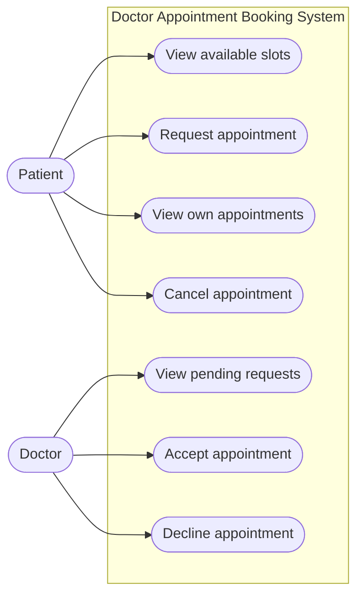

# P2 — Use Cases

## Actors

- **Patient:** Views doctor availability and requests an appointment.
- **Doctor:** Reviews appointment requests and accepts or declines them.

## UC1 — View Available Appointment Slots

**Primary actor:** Patient  
**Precondition:** The system has doctors and scheduled availability.  
**Main flow:**
1. The patient requests the available slots for a doctor.
2. The system retrieves future slots that are not already booked.
3. The system displays the available dates and times.
**Postcondition:** The patient can choose one of the displayed slots.

## UC2 — Request an Appointment

**Primary actor:** Patient  
**Preconditions:** The patient and doctor exist; the selected slot is in the future.  
**Main flow:**
1. The patient selects a doctor and an available slot.
2. The system checks that the slot is still available.
3. The system counts the patient's future `Pending` and `Accepted` appointments.
4. If the count is below N (N = 3), the system creates a `Pending` appointment.
5. The system confirms that the request was created.
**Alternative flow A1 — Slot is unavailable:** At step 2, if another appointment has taken the slot, the system rejects the request and asks the patient to select another slot.
**Alternative flow A2 — Appointment limit reached:** At step 3, if the patient already has N upcoming `Pending` or `Accepted` appointments, the system rejects the request.
**Postcondition:** A new pending request exists only if all validations pass.

## UC3 — Review an Appointment Request

**Primary actor:** Doctor  
**Precondition:** A pending appointment request exists for the doctor.  
**Main flow:**
1. The doctor views pending requests.
2. The doctor selects a request.
3. The doctor chooses Accept or Decline.
4. The system updates the appointment status.
**Alternative flow:** If the appointment is no longer pending, the system refuses to change its decision status.
**Postcondition:** The appointment is `Accepted` or `Declined`.

## UC4 — Cancel an Appointment

**Primary actor:** Patient  
**Precondition:** The patient has an upcoming appointment with status `Pending` or `Accepted`.
**Main flow:**
1. The patient requests cancellation of their appointment.
2. The system verifies the appointment belongs to the patient and is upcoming.
3. The system changes the status to `Cancelled`.
**Postcondition:** The cancelled appointment no longer counts toward the N limit.

# P3 — Use Case Diagram

